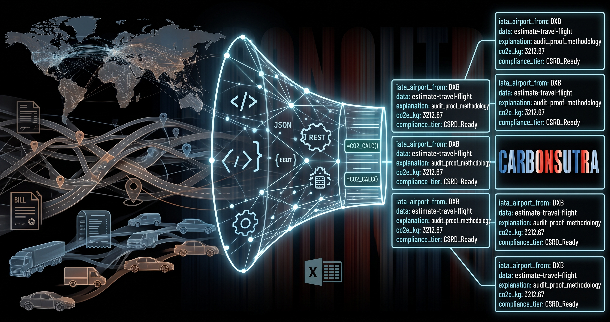

After running our platform for four years and calculating millions of carbon footprints worldwide, one question comes up more than any other:

> _"What makes CarbonSutra different from other carbon calculation APIs?"_

Our core answer remains the same as when we launched in 2022. But with global climate rules (like Europe’s CSRD and California’s SB 253) turning voluntary ESG goals into strict legal requirements, _how_ you calculate emissions matters more than ever.

Most carbon tools act like "black boxes". They take basic inputs, run them through hidden assumptions, and give you a single number. That might work for a general estimate, but if you are an enterprise platform builder, software engineer, or accountant facing a formal audit, a number without proof or an explanation of calculation is a liability.

We built CarbonSutra around **five practical pillars** to bring total clarity to emissions tracking.

## The 5 Core Pillars of CarbonSutra

### 1\. Practical Accuracy

Calculating a straight-line flight between two airports is simple—and usually wrong. Real-world logistics need real-world detail:

- **E-commerce & Freight Logistics:** We match 1.5 million postal codes across 95 countries to the nearest airports. We combine road and air routes to reflect the actual journey of your packages.
- **Specific Fleet Modeling:** Instead of guessing emissions based on vague categories like "big car" or "small car," our database covers over 5,000 specific vehicle models across 150 makes.

### 2\. Complete Boundaries

Standard calculators often skip the hidden parts of an operational footprint. We give you direct options to include them:

- **Radiative Forcing (RF):** Capturing the extra climate impact of flight emissions at high altitudes.
- **Well-to-Tank (WTT) Factors:** Accounting for upstream emissions created while extracting, refining, and transporting fuel before it ever burns.

### 3\. Dynamic Explanations (No "Black Boxes")

Every calculation request made to CarbonSutra returns a plain-English, mathematically complete **Explanation** inside the response. It shows the exact data sources (such as UK DEFRA standards or Cornell hotel benchmarks), formulas, and unit conversions used. Your audit trail is created in real time alongside your data.

```json
{
  "data": {
    "type": "estimate-hotel-stay",
    "country": "India",
    "city_name": "Mumbai",
    "hotel_rating": "4",
    "number_of_nights": "3",
    "number_of_rooms": "1",
    "co2e_gm": 182160,
    "co2e_kg": 182.16,
    "co2e_mt": 0.18,
    "co2e_lb": 401.59,
    "explanation": "CarbonSutra uses the Cornell Hotel Sustainability Benchmarking Index 2026 (CHSB2026) for this calculation, specifically leveraging the mean value from the CHSB validity test for Measure 1 - HCMI Room Night Emission (Carbon Category). Because specific emission factors for Mumbai are unlisted in CHSB2026, fallback data for India has been applied to this calculation of one room and 3 nights. This methodology relies on the Expedia Star Rating classification system. Where regional data gaps exist, proxy assignments are made according to the transparent governance rules published on carbonsutra.com. For the hotel rating of four stars, an emission factor of 60.72 kgCO2e per room night is used. This footprint evaluates to 182,160 grams of CO2e. Standardized unit conversions render this as 182.16 kg (rounded to two decimal places) or 0.18 metric tons. Scaled against imperial baselines using the conversion factor of 2.20462 (source: GHG conversion factors, 2026), the final metric is expressed as 401.59 lbs."
  },
  "success": true,
  "status": 200
}
```

### 4\. Simple Developer Integration

- **Instant Code Snippets:** As you test endpoints in our sandbox, CarbonSutra automatically writes copy-paste code snippets in over 18 common programming languages (Python, Node.js, cURL, Go, Java, and more).
- **Zero-Storage Clustering:** Use our **Clustering API** to tag, group, and fetch batches of calculations using your own custom labels. You can track quarterly or project emissions without setting up database tables on your end. This is instrumental in our upcoming APIs that comply to common communication structures like [OpenCCF](https://openccf.org/).

### 5\. Fair and Open Access

We believe sustainability tools should be accessible to developers at every stage:

- **Free Tier:** Start with up to 100-200 free API calls per month with no setup fees.
- **Free for Non-Profits:** Full, unthrottled API access is completely free for registered non-profits and charities, no matter the volume.
- **Commercial Scale:** Simple, transparent paid options for high-volume commercial systems.

---

## Choose How You Build

Whether you are writing code, working in spreadsheets, or building AI tools, CarbonSutra connects directly into your existing workflow:

| Interface                   | Ideal For                       | Key Benefit                                                                                       |
| --------------------------- | ------------------------------- | ------------------------------------------------------------------------------------------------- |
| **REST APIs**               | Software Engineers & Tech Teams | Embed direct Scope 1, 2, and 3 calculations into apps, ERPs, and portals.                         |
| **Google Sheets Functions** | ESG Managers & Accountants      | Use custom functions (`CO2FLIGHT`, `CO2HOTEL`, etc.) for code-free bulk calculations.             |
| **MCP Server**              | AI Engineers & Automation Teams | Connect our engine directly to AI assistants (like Claude or Cursor) for natural language audits. |

---

Ready to test your first calculation (if you are already not onboard!)? Explore our documentation or run a test query today at [www.carbonsutra.com](https://www.carbonsutra.com).

#CarbonSutra #CarbonAccounting #ESG #Sustainability #APIs #GreenOps #Scope3
